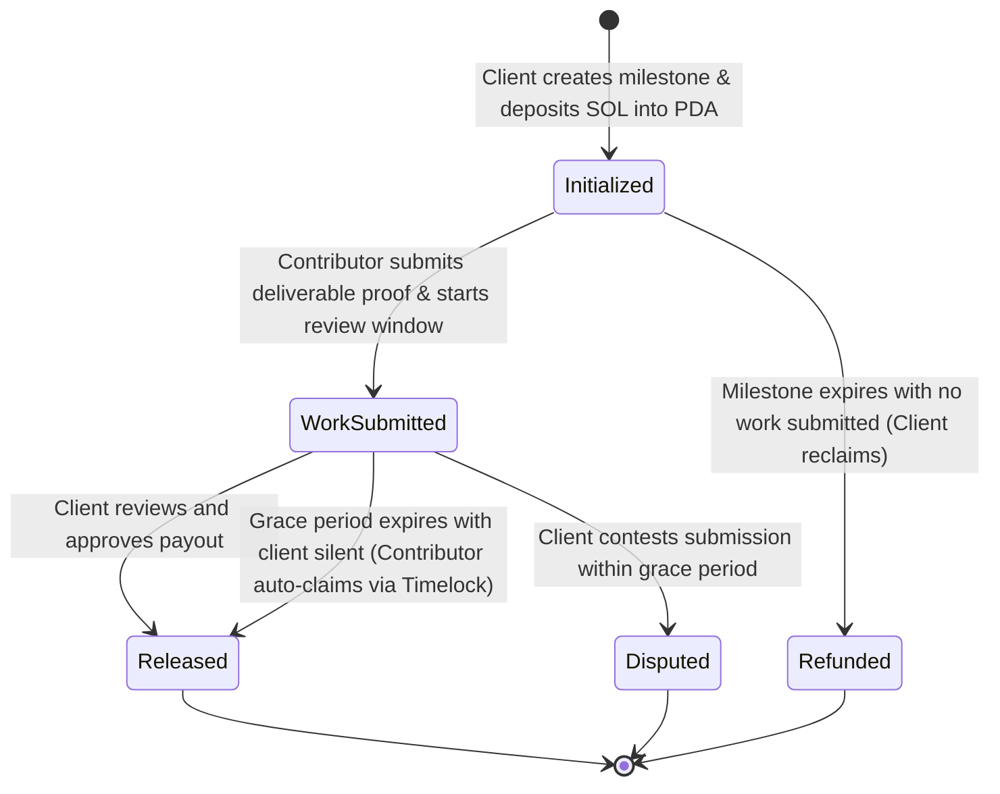

# ⚡️ PeerEscrow — Trustless Milestone Finance on Solana

> **Finance Without Intermediaries** | Built for **HackYeah 2026 — Superteam Poland Track**  
> Direct peer-to-peer milestone escrow and bounty protocol on Solana. 0% platform extraction, zero KYC barriers, and autonomous timelock releases.

---

## 🌟 The Problem: Intermediary Rent Extraction & Censorship

Modern freelance, bounty, and remote work platforms (Upwork, Fiverr, traditional escrow services) are built on heavy intermediary choke points:
- **Exorbitant Take Rates:** Traditional platforms extract **10% to 20%** of total contract value from both clients and contributors.
- **Arbitrary Account Freezes & KYC:** Cross-border builders and talent face opaque verification loops, frozen payouts, and geographic discrimination.
- **Ghosting & Hostage Milestones:** When clients become unresponsive after work is delivered, contributors have no automated recourse without waiting weeks for human arbitration panels that often rule unfairly.

## 💡 The Solution: PeerEscrow

PeerEscrow replaces trusted third parties, escrow corporations, and arbitration middlemen with deterministic, code-enforced Solana smart contracts:

1. **0% Middleman Cut:** 100% of the funds go directly from client to contributor.
2. **Deterministic Program Derived Address (PDA) Vaults:** Escrowed SOL is locked in program-owned state accounts keyed by `[b"escrow", client_pubkey, task_id]`.
3. **Autonomous Contributor Protection (Timelock Claim):** Once work is submitted with cryptographic proof (Git commit hash, IPFS CID, or PR URL), an autonomous review timelock begins. If the client goes silent past the grace period, the contributor can autonomously trigger payout release without any intermediary!
4. **Client Inactivity Refund:** If the contributor fails to submit deliverables before the deadline, the client retains sovereign authority to reclaim their SOL.

---

## 🏗 System Architecture & State Machine



### Protocol PDA Derivation
```rust
seeds = [
    b"escrow",
    client.key().as_ref(),
    task_id.as_bytes()
]
```

---

## 📜 On-Chain Program Specification (Anchor)

The Solana program is implemented in Anchor (`0.30.1`) targeting Solana runtime `1.18.x`:

| Instruction | Signer | PDA Seeds | Description |
| :--- | :--- | :--- | :--- |
| `initialize` | Client | `[b"escrow", client, task_id]` | Locks milestone SOL in vault; records contributor, deadline, and grace window. |
| `submit_work` | Contributor | `[b"escrow", client, task_id]` | Stores deliverable proof and activates the client review countdown timer. |
| `release` | Client | `[b"escrow", client, task_id]` | Client signs release; PDA transfers 100% of escrow balance directly to contributor. |
| `claim_timelock` | Contributor | `[b"escrow", client, task_id]` | Autonomously transfers escrow balance if client remains unresponsive past grace window. |
| `refund` | Client | `[b"escrow", client, task_id]` | Client reclaims deposit if milestone deadline passes without work submitted. |

---

## 💻 Tech Stack

- **Solana Smart Contracts:** Rust, Anchor Framework (`0.30.1`), Solana Program Library.
- **Frontend Dashboard:** React 18, Vite, TypeScript, Tailwind CSS, Lucide Icons.
- **Wallet Integration:** `@solana/wallet-adapter-react`, Phantom, Solflare, Backpack (Devnet & Mainnet ready).
- **Web3 RPC:** `@solana/web3.js`.

---

## 🚀 Getting Started

### Prerequisites
- Node.js >= 18
- Rust & Cargo (1.75+)
- Solana CLI Tools (v1.18+)
- Anchor CLI (v0.30+)

### 1. Clone & Setup Frontend
```bash
git clone https://github.com/shitobu/peer-escrow.git
cd peer-escrow/app
npm install
npm run dev
```

The application will launch at `http://localhost:5173`. Connect your Solana wallet (configured to **Devnet**).

### 2. Smart Contract Build & Test
```bash
# From repository root
anchor build
anchor test
```

---

## 🛡 Security & Edge Case Handling

1. **Re-entrancy Immunity:** State is updated to terminal statuses (`Released`, `Refunded`) before SOL lamport balance adjustments.
2. **Signer Validation:** Strict Anchor constraint checks ensure only designated contributors can submit work or claim timelocks, and only the original client can release or refund.
3. **Zero Intermediary Privilege:** There are no admin keys, platform backdoors, or fee extraction addresses.

---

## 👥 HackYeah 2026 Superteam Poland Track Submission
- **Track:** Finance Without Intermediaries
- **Applicant:** `shitobu`
- **Submission Repository:** [github.com/shitobu/peer-escrow](https://github.com/shitobu/peer-escrow)
- **License:** MIT
